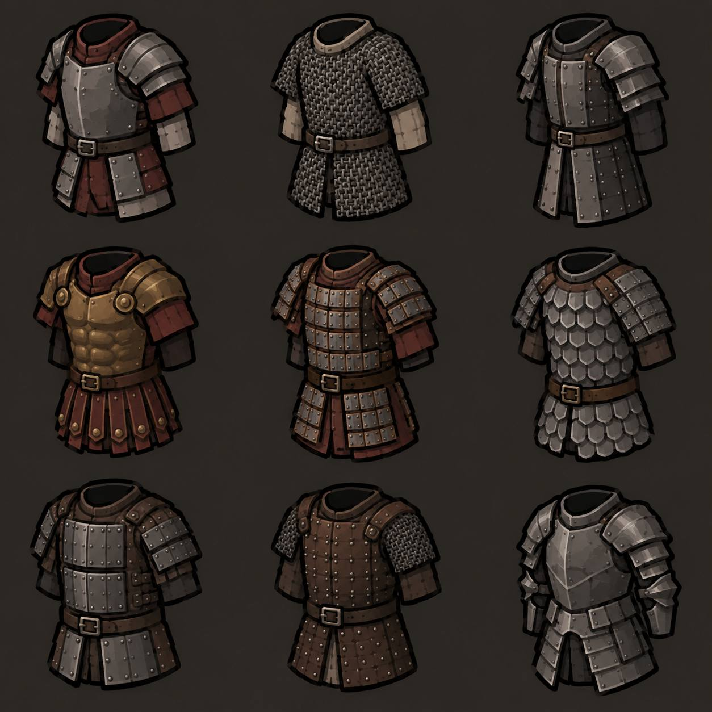

# Визуальный референс брони MiniLife

Зафиксирован по указанию пользователя 2026-11-04: «запомни этот стиль».

## Характер стиля

- Рисованная стилизованная 2D-графика средневекового снаряжения, не пиксель-арт.
- Толстый тёмный внешний контур, чёткий и легко узнаваемый силуэт.
- Объём через крупные грани света и тени, сдержанные блики и живую живописную фактуру.
- Приглушённая палитра: серое железо, тёмно-коричневая кожа, бордовая ткань, охристая бронза.
- Материалы различаются фактурой: кольчужные звенья, металлические пластины и заклёпки, матовая кожа и ткань.
- Умеренная потёртость и неровность поверхности без чрезмерной грязи.
- Компактные, слегка преувеличенные пропорции, читаемые в игровой иконке.
- Предмет показан отдельно, без тела персонажа, в едином лёгком ракурсе три четверти с видимой горловиной.
- Детали подчиняются общей форме: пояс, наплечники, подол и слои брони хорошо отделены друг от друга.

## Композиция референса

Девять доспехов расположены сеткой 3×3 на однотонном тёмном тёплом фоне, без подписей. Сетка и фон относятся к представленному листу; формат отдельных игровых спрайтов определяется конкретной задачей.

## Применение

Использовать этот образец как согласованный визуальный ориентир для дальнейших изображений брони MiniLife. Он задаёт художественную подачу, а характеристики, материалы и состав конкретного предмета берутся из каталога проекта. Существующие изображения автоматически не заменяются.
